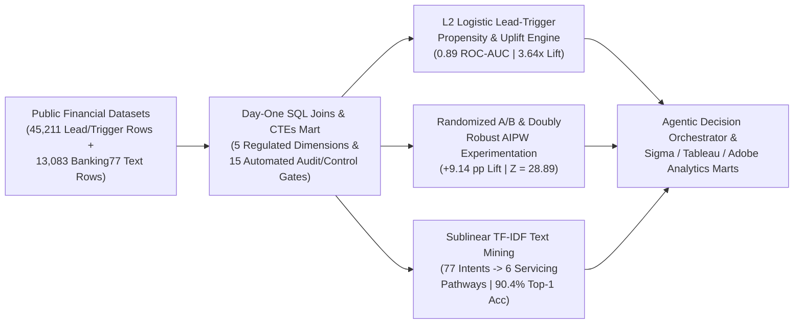

# Small Business Product Analytics, Lead-Trigger Experimentation, Text Mining & Agentic Decision Engine

Production-grade Small Business product analytics, scalable lead- and trigger-driven demand generation, randomized experimentation & Doubly Robust AIPW causal inference, statistical text mining (`Sublinear TF-IDF + Complement Log-Odds` across `77` banking intents), and 4-node Agentic AI decision support in a regulated financial environment.

---

## 1. Executive Summary & Verified Results (`58,294` Public Records)

| Analytical & Engineering Dimension | Verified Output |
| :--- | :--- |
| **Combined Public Records Processed** | **`58,294`** (`45,211` lead/trigger journey records + `13,083` servicing text utterances) |
| **Lead-Trigger Propensity Model (`36,168` Train / `9,043` Holdout)** | **`0.8889` (`0.89`) Holdout ROC-AUC**, **`0.4890` PR-AUC**, **`0.0770` Brier Score** (**`25.45%` improvement** over baseline `0.1033`) |
| **Top-20% Lead-Trigger Demand Generation Lift** | **`42.64%` conversion rate** vs. **`11.70%` baseline** (**`3.64x` lift**, capturing **`72.87%`** of total conversions) |
| **Digital Trigger Experimentation (`Treatment` vs. `Control`)** | **`14.92%` vs. `5.78%` conversion** (**`+9.14 pp` / `+158.26%` relative lift**, $Z = 28.89$, $p = 1.57 \times 10^{-183}$); **Doubly Robust AIPW ATE `+2.92 pp`** (`SE = 0.26 pp`) |
| **Statistical Text Mining (`13,083` Utterances / `77` Intents / `6` Pathways)** | **`90.36%` Top-1** & **`97.89%` Top-2** holdout servicing pathway accuracy across **`22,866` TF-IDF n-gram features** |
| **Day-One Product Launch KPI & Audit Controls** | **`15 / 15` (`100.0%`)** automated financial, operational, KYC controls, audit traceability, and product checks passed |
| **Automated Unit & Statistical Test Suite** | **`6 / 6` (`100.0%`)** unit tests passing (`tests/test_smb_product_analytics.py`) |

---

## 2. System Architecture



---

## 3. Repository Structure

```text
smb-product-lead-trigger-agentic-analytics/
├── README.md
├── docs/
│   └── schema_and_methodology.md
├── outputs/
│   ├── agentic_decision_audit_log.json
│   ├── experimentation_and_trigger_results.json
│   ├── smb_product_kpi_scorecard.csv
│   ├── text_mining_servicing_pathways.csv
│   └── unit_test_results.txt
├── sql/
│   └── smb_product_kpi_and_funnel_mart.sql
├── src/
│   └── smb_product_analytics_engine.py
└── tests/
    └── test_smb_product_analytics.py
```

---

## 4. Reproducing Results Locally

Zero external dependencies are required (runs out-of-the-box with Python 3 standard library + SQLite):

```bash
PYTHONPATH=. python3 src/smb_product_analytics_engine.py
PYTHONPATH=. python3 -m unittest discover -s tests -v
```
